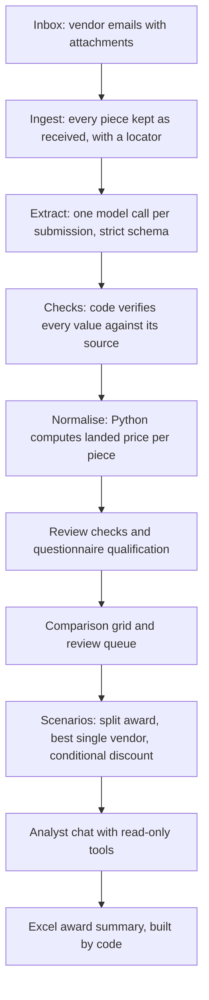

# Architecture

## 1. Ingest

Each email becomes a submission: sender, date, subject, body and attachments. Each attachment is broken into **evidence units**, every one with a locator:
- spreadsheet cells keep their sheet and cell reference, including extra tabs such as Terms;
- Word paragraphs are numbered;
- PDF text is kept per page, and each page is also rendered as an image;
- photos are kept as images.

A PDF page with almost no text is treated as a scan.

Vendor documents are treated as untrusted input. Files get generated names, there are size caps, and vendor text shown on screen is escaped so it can't load outside content in the buyer's browser.

## 2. Extract

One language-model call per submission, forced through a strict JSON schema. For each line it returns:
- the matching RFQ item;
- the raw value and the raw text, copied word for word;
- the unit basis, currency, tax basis and freight basis;
- the specification offered;
- the source (file, locator, snippet);
- a confidence level.

It also returns lines not quoted, commercial terms, questionnaire answers, the attached documents with their validity dates, and **ambiguities**: what is unclear, the possible readings, and the question to ask the vendor.

The model never converts or adds numbers. Results are cached by file, so the hosted app opens instantly and makes no model calls until a reviewer uploads a new quote.

## 3. Normalise (Python only)

Every cell becomes a price per piece, excluding tax, delivered to the plant:
- **Weight per unit** comes from the RFQ specification: board weight from the paper layers and flute factors, and the flat-sheet size from the box style. Every allowance comes from the buyer's assumptions, not from code.
- **Unit conversion:** per 100, per 1,000, per kg (times the weight) and per strip (times the strips per set).
- **Currency:** the exchange rate used is shown with its date.
- **Tax:** a price that includes tax has the tax taken out.
- **Freight:** an ex-works price gets an estimated freight per kg for the vendor's lane, labelled as an estimate.
- **"Same as last year":** looked up from last year's prices and labelled Inferred.
- **One-time charges** such as plates and dies are shown separately, and amortised only where the screen says so.

Every result carries a formula string, its inputs, its source and a status.

## 4. Checks and qualification

Generic rules feed the review queue:
- low confidence;
- a price far outside the other vendors' range (a likely unit mismatch);
- a specification below the RFQ, or a size outside tolerance;
- lapsed quote validity, or an escalation clause;
- a questionnaire not returned;
- an answer contradicted by an attachment, such as a certificate that expired before the due date;
- two or more believable readings.

For the supplier questionnaire, the model reads the wording of each answer and code applies the pass rules. Numeric rules (capacity against peak demand, lead time, rejection rate) and certificate dates are decided by code. The buyer can override any verdict, and the original verdict is kept.

## 5. Analyst

A chat where the model answers only by calling tools on the session's data, never from memory:
- **run_sql:** read-only queries, guarded twice; the database's own access to outside files is switched off;
- **split_award, whole_basket and what_if:** these reuse the same scenario code as the screens, so the chat and the screens can't disagree;
- **make_chart, export_excel and answer.**

After every answer, code checks that each number in the conclusion matches a number from that turn's tool results, and highlights any that don't. The award summary in Excel is built by code, not by the model.

**Limits:**
- at most 6 tool rounds per question;
- one SQL retry;
- a cost cap per question;
- a fixed number of questions per session.

## 6. Hosting

The app is hosted on Streamlit Community Cloud behind a password gate. The API key and password live in the host's secrets store, and the app refuses to open if the password is not set. Each viewer's decisions live in their own browser session, so reviewers never see each other's changes. Live extractions are rate-limited per session and per day.
